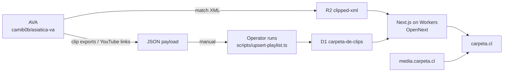

# Carpeta de Clips

[carpeta.cl](https://carpeta.cl) is a Spanish field-hockey clip library. Each team has a carpeta of match clips, filterable by game concept and rival. Clips open in a modal with YouTube or self-hosted playback, and links can share a team view, an open clip, or a specific play (`clip` and `jugada` query params).

Code lives in this repository. The catalog is Cloudflare D1; match XML lives in R2. The site runs on Cloudflare Workers via [OpenNext](https://opennext.js.org/cloudflare). Licensed under [MIT](LICENSE).

## Architecture

[AVA](https://github.com/camib0b/asiatica-va) is the desktop tagging app that exports match XML and compiled clips. Match XML is stored in the R2 bucket `clipped-xml`. An operator builds a JSON payload and runs `scripts/upsert-playlist.ts` with Wrangler to write YouTube links, optional media keys, and play instances into D1 (`carpeta-de-clips`). Next.js on Cloudflare Workers (OpenNext) serves carpeta.cl from that catalog, serves XML from R2 (with a local `public/match-xml` fallback in development), and points self-hosted video at `https://media.carpeta.cl`.



## Stack

- Next.js 16 and React 19
- OpenNext on Cloudflare Workers
- Cloudflare D1 (catalog) and R2 (`clipped-xml` for XML; public `carpeta-clips` at `media.carpeta.cl` for MP4s)
- Wrangler for migrations, D1 execute, and deploy

## Getting started

Package manager is **pnpm** (`pnpm-lock.yaml`). For remote D1 or deploy, run `wrangler login` first.

```bash
pnpm install
pnpm run db:migrate:local
pnpm dev
```

`db:migrate:local` applies every pending file under `migrations/` to Wrangler’s local D1 (required before home and team pages can list clips). Open [http://localhost:3000](http://localhost:3000).

```bash
pnpm test
```

## Catalog database (D1)

| | |
|---|---|
| Database name | `carpeta-de-clips` |
| Binding | `DB` (`wrangler.jsonc`) |
| Migrations | `migrations/` |

```bash
pnpm run db:migrate:local    # wrangler d1 migrations apply … --local
pnpm run db:migrate:remote   # same, --remote (needs wrangler login)
```

Both commands apply all pending migrations (Wrangler records them in `d1_migrations`). There is no separate seed command: `0002_seed_catalog.sql` is the initial catalog (`INSERT OR IGNORE`).

| Migration | What it does |
|---|---|
| `0001_create_catalog.sql` | `libraries`, `matches`, `clips` + indexes |
| `0002_seed_catalog.sql` | Initial libraries, matches, and clips |
| `0003_clip_instances.sql` | `clip_instances` (plays inside a compiled clip) |
| `0004_others_library_display_name.sql` | Display name `Otros` for library `others` |
| `0005_clip_self_hosted_media.sql` | Optional `r2_key`, `r2_key_low`, `fps`, `duration_s`, `visibility` on `clips` |
| `0006_clip_thumbnail_key.sql` | Optional `thumb_key` (JPEG poster in `carpeta-clips`) on `clips` |

`pnpm run db:seed:generate` no longer regenerates `0002`: `lib/clip-catalog.ts` no longer exports the old `videoClips` array. Use the committed migration (or `scripts/upsert-playlist.ts` for new matches).

Smoke-check local D1 after migrate:

```bash
pnpm run db:parity
```

## Plays inside a clip

Compiled uploads can contain several plays. Rows in `clip_instances` store `ord`, timeline `offset_s`, and `duration_s` (plus optional quarter / score / XML id). The modal seeks between plays with swipe (mobile) or keyboard; share links may include `?clip=<id>&jugada=<ord>`.

## Match XML

Production XML is read from R2 (`CLIPPED_XML` → `clipped-xml`) using `matches.r2_xml_object_key`. If R2 has no object, local development falls back to files under `public/match-xml/` (see that folder’s README for naming).

## Self-hosted clip video

When `mediaUrl()` in `lib/media-url.ts` returns a URL, the modal plays a native `<video>`; otherwise it uses the YouTube embed. Library cards and the home “último partido” row use `clips.thumb_key` when set (versioned `*.thumb.<hash>.480.webp` on `https://media.carpeta.cl`, with a matching `640.webp` sibling for `srcset`), then a real YouTube `mqdefault` poster, then a neutral placeholder (placeholder `youtube_id` values such as `pending-…` skip YouTube). Grids do not autoload MP4 metadata for posters. Objects live in the public R2 bucket `carpeta-clips`. Set `NEXT_PUBLIC_MEDIA_BASE_URL` as documented in `.env.example`. Team-inbox files use the `inbox/` prefix on that same public host: add a Cloudflare rule that blocks public access to `inbox/` on `media.carpeta.cl` before setting `TEAM_INBOX_ENABLED=true`.

The home `#equipos` offer prices each match on a 2×2 matrix: **Nivel de detalle** (Básico or Exhaustivo) and **Plazo** (Estándar, 3 days, or Express, 24 hours). CLP amounts are Básico+Estándar $21.000, Básico+Express $32.000, Exhaustivo+Estándar $30.000, and Exhaustivo+Express $39.990. Fintoc links are built as `https://fintoc.me/cami-escu/<amount>` from the selected price. The clock starts when both the payment and the video file have arrived. Mail for that inbox goes to `video@camilaescudero.cl`. In production the section and `/api/team-inbox` stay closed until `TEAM_INBOX_ENABLED` is exactly `true`.

**Deploy order (when this ships):** apply D1 migration `0006`, run the thumbnail backfill, then deploy the Worker/site (catalog reads `thumb_key` in `CLIP_JOIN_SELECT`).

| Column | Meaning |
|---|---|
| `r2_key` | Primary MP4 object key (nullable) |
| `r2_key_low` | Optional smaller copy |
| `thumb_key` | Optional JPEG poster for library cards (nullable) |
| `fps` | Frames per second (nullable; frame step defaults to 30) |
| `duration_s` | Full-file duration in seconds (nullable) |
| `visibility` | `public` (default) or `restricted` |

### Clip card thumbnails

Generate versioned WebP posters from the self-hosted MP4 (~1s in, 480w + 640w, `immutable` cache headers) and upload to R2:

```bash
# After applying migration 0006 on remote D1:
pnpm exec tsx scripts/generate-clip-thumbnails.ts --remote --all-missing --execute-sql

# One match (storage slug = matches.id):
pnpm exec tsx scripts/generate-clip-thumbnails.ts --remote --match '2026-10-25--UC_Sub_16_A--Manquehue--MQA' --execute-sql
```

`scripts/upsert-playlist.ts` runs the same generator for the match when the payload includes `r2Key` (skip with `--skip-thumbnails`). Requires `ffmpeg` on PATH.

`mediaUrl` returns null (YouTube fallback) when there is no `r2_key`, when `visibility` is not `public`, or when the media base URL is unset. Restricted clips are not served yet.

Low media is preferred when the viewport is under 768px, `navigator.connection.saveData` is set, or `downlink` is under 3 Mbps (`shouldPreferLowMedia` in `lib/clip-player.ts`). If `r2_key_low` is set and low media is preferred, that copy plays; otherwise playback uses `r2_key`. While paused, `,` and `.` step one frame using stored `fps` (including rates such as 59.94). Speed presets are 0.25×, 0.5×, 1×, and 2×.

## Adding a playlist

Do not put clips back into a TypeScript array. Build a JSON payload and apply it with Wrangler:

```bash
pnpm exec tsx scripts/upsert-playlist.ts --local path/to/payload.json
pnpm exec tsx scripts/upsert-playlist.ts --remote path/to/payload.json   # needs wrangler login
pnpm exec tsx scripts/upsert-playlist.ts --sql-only path/to/payload.json # print SQL only
```

Without `--remote`, the script targets local D1. Payload shape (`match` + `clips[]`; clip `matchId` comes from `match.id`):

```json
{
  "match": {
    "id": "2026-05-16--Old_Gabs--Old_Reds--Old_Gabs_vs_Old_Reds--Others",
    "playedOn": "2026-05-16",
    "homeTeam": "Old Gabs",
    "awayTeam": "Old Reds",
    "homeGoals": 1,
    "awayGoals": 1,
    "shootoutWinner": null,
    "place": null,
    "division": "Primera A",
    "libraryId": "others",
    "rivalLabel": "Old Gabs vs Old Reds",
    "youtubePlaylistId": null,
    "r2XmlObjectKey": "OGA vs OR.xml"
  },
  "clips": [
    {
      "youtubeId": "xxxxxxxxxxx",
      "title": "Example concept",
      "gameConcept": "Presiones",
      "uploadedAt": "2026-05-20T12:00:00.000Z",
      "r2Key": "matches/example.mp4",
      "r2KeyLow": null,
      "fps": 30,
      "durationS": 120,
      "visibility": "public",
      "instances": [
        { "ord": 1, "offsetS": 0, "durationS": 19.0 },
        { "ord": 2, "offsetS": 19.0, "durationS": 13.0 }
      ]
    }
  ]
}
```

`instances` is optional. On `youtube_id` conflict, title / concept / match / upload time are not rewritten; media columns use `COALESCE` so omitted keys are kept; `visibility` uses `CASE` so a null import leaves the stored value (including `restricted`). New rows still default to `public`. Match `r2_xml_object_key` also uses `COALESCE` on conflict.

## Deploy

```bash
pnpm run db:migrate:remote
pnpm run deploy
```

Related scripts:

- `pnpm run preview` — OpenNext build + local Workers preview (local D1; migrate first)
- `pnpm run upload` — OpenNext build + upload without the full deploy flow
- `pnpm run cf-typegen` — regenerate `cloudflare-env.d.ts` from Wrangler

Worker config is `wrangler.jsonc`:

- R2 binding `CLIPPED_XML` → bucket `clipped-xml`
- D1 binding `DB` → database `carpeta-de-clips`

Home and team library pages are `force-dynamic` so they read D1 at request time.

For Cloudflare Workers Builds, use `pnpm exec opennextjs-cloudflare build` (not `pnpm run build`, which is Next.js only).
