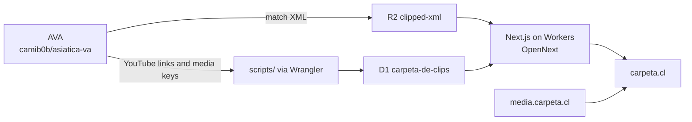

# Carpeta de Clips

Hockey video library for working with the team. Source of truth for **code** is this GitHub repository. The **clip catalog** lives in Cloudflare D1. XML blobs stay in R2. Production runs on Cloudflare Workers via [OpenNext](https://opennext.js.org/cloudflare) and Wrangler.

Live site: [carpeta.cl](https://carpeta.cl)

## Architecture

[AVA](https://github.com/camib0b/asiatica-va) exports each match as XML and compiled clips. Match XML is stored in the R2 bucket `clipped-xml`; scripts in `scripts/` write YouTube links and clip media keys into the D1 catalog `carpeta-de-clips` with Wrangler. Next.js on Cloudflare Workers (OpenNext) serves [carpeta.cl](https://carpeta.cl), reading that catalog and clip video from `https://media.carpeta.cl`.



## Getting started

Package manager is **pnpm** (`pnpm-lock.yaml`).

```bash
pnpm install
pnpm run db:migrate:local
pnpm dev
```

`db:migrate:local` applies schema + the catalog seed to Wrangler’s local D1 (needed before home/team pages can list clips).

Open [http://localhost:3000](http://localhost:3000). Edit `app/page.tsx` (home) or `app/[teamSlug]/page.tsx` (team libraries); the page reloads as you save.

## Catalog database (D1)

| | |
|---|---|
| Database name | `carpeta-de-clips` |
| Binding | `DB` (`wrangler.jsonc`) |
| Migrations | `migrations/` |

```bash
# Local (wrangler state under .wrangler/)
pnpm run db:migrate:local

# Production: schema (0001) + catalog seed (0002) in one command
pnpm run db:migrate:remote
```

Those commands wrap:

```bash
pnpm exec wrangler d1 migrations apply carpeta-de-clips --local
pnpm exec wrangler d1 migrations apply carpeta-de-clips --remote
```

Wrangler records each applied file in the `d1_migrations` table. This repo sets `migrations_dir` to `migrations/` and does not set `migrations_table`, so the default table name is used. Apply pending migrations before a deploy that reads new columns.

There is **no separate remote seed command**. `0002_seed_catalog.sql` is the seed (`INSERT OR IGNORE` of libraries, matches, and clips). Apply `--remote` before a deploy that reads D1, or the live site will be empty.

- `0001_create_catalog.sql` — `libraries`, `matches`, `clips` + indexes (`matches.division` is the league, e.g. Primera A)
- `0002_seed_catalog.sql` — snapshot of the former clip-catalog array (scores/dates copied, not invented; `libraryName` → `library_id`, `division` → `matches.division`)
- `0005_clip_self_hosted_media.sql` — optional self-hosted MP4 columns on `clips` (`r2_key`, `r2_key_low`, `fps`, `duration_s`, `visibility`)

Regenerate `0002` only if the TypeScript sources are restored from git history:

```bash
pnpm run db:seed:generate
```

New playlists: upsert into D1 with `scripts/upsert-playlist.ts` (see `.cursor/skills/add-youtube-playlist`). Do not add clips back into a TypeScript array.

Smoke-check local D1:

```bash
pnpm run db:parity
```

## Self-hosted clip video

The clip modal plays a native `<video>` when `mediaUrl()` returns a URL, and otherwise keeps the YouTube embed. Thumbnails stay on YouTube. Files live in the public R2 bucket `carpeta-clips` at `https://media.carpeta.cl`.

`migrations/0005_clip_self_hosted_media.sql` adds:

| Column | Meaning |
|---|---|
| `r2_key` | MP4 object key that plays, nullable. A 720p source lives here and leaves `r2_key_low` null. |
| `r2_key_low` | optional smaller copy. When null, playback still uses `r2_key`. |
| `fps` | frames per second, nullable |
| `duration_s` | full-file duration in seconds, nullable |
| `visibility` | `public` (default) or `restricted` |

Existing rows stay playable: the media columns are null and `visibility` is `public`. A playlist import that omits those fields does not clear them (`COALESCE` on `youtube_id` conflict). New rows still default `visibility` to `public`.

`mediaUrl()` in `lib/media-url.ts` is the only builder of self-hosted video URLs. It reads `NEXT_PUBLIC_MEDIA_BASE_URL` and returns null when that variable is unset, when the clip has no `r2_key`, or when `visibility` is not `public`. The null restricted case is the hook for a later gated Worker or signed URL.

The modal asks for `r2_key_low` when the viewport is under 768px, when `navigator.connection.saveData` is set, or when `downlink` is under 3 Mbps. If that column is null, it plays `r2_key`. Otherwise it plays `r2_key` directly. While that video is paused, `,` and `.` step one frame using the stored `fps` (including fractional rates such as 59.94), or 30 when `fps` is missing. Speed presets are 0.25×, 0.5×, 1×, and 2×.

Next inlines `NEXT_PUBLIC_*` at **build** time, into the browser bundle. This repo commits the public origin:

| File | When Next loads it |
|---|---|
| `.env.production` | `next build`, including `opennextjs-cloudflare build` |
| `.env.development` | `pnpm dev` |

`wrangler.jsonc` `vars` are Worker runtime bindings. OpenNext copies them onto `process.env` inside the Worker after the client bundle already exists, so they do **not** set `NEXT_PUBLIC_MEDIA_BASE_URL` for the player. A variable of that name in the Cloudflare Workers Builds environment does override `.env.production`, because Next leaves variables that are already set. Changing the URL requires a new build. See `.env.example`.

Production D1 already has this migration applied. On a database that does not, apply it before deploying the code that selects the new columns:

```bash
pnpm exec wrangler d1 migrations apply carpeta-de-clips --remote
```

`pnpm run db:migrate:remote` is that same command. Wrangler skips files already listed in `d1_migrations`.

## Deploy (Cloudflare)

Production uses OpenNext + Wrangler on Cloudflare Workers:

```bash
pnpm run db:migrate:remote   # once, or whenever migrations/ changes
pnpm run deploy
```

Related scripts:

- `pnpm run preview` — OpenNext build + local Workers preview (uses local D1; migrate first)
- `pnpm run upload` — OpenNext build + upload without the full deploy flow
- `pnpm run cf-typegen` — regenerate `cloudflare-env.d.ts` from Wrangler

Worker config lives in `wrangler.jsonc` (OpenNext):

- R2 binding `CLIPPED_XML` → bucket `clipped-xml` (XML file bytes)
- D1 binding `DB` → database `carpeta-de-clips` (libraries / matches / clips, including `r2_xml_object_key`)

Home and team library pages are **dynamic** (`force-dynamic`) so they read D1 at request time instead of baking the catalog into the Worker bundle.

**Cloudflare Workers Builds** (Dashboard → Workers → Builds): set the build command to:

```bash
pnpm exec opennextjs-cloudflare build
```

Do not use `pnpm run build` there — that is Next.js only and does not produce the Worker.

**Dashboard check:** Wrangler config is enough to bind `DB` on the next deploy. Confirm in Cloudflare Dashboard → Workers → `carpeta-de-clips` → Bindings that `DB` points at database `carpeta-de-clips`. Apply remote migrations before or with that deploy (`0001`/`0002` are `IF NOT EXISTS` / `INSERT OR IGNORE`, so re-running is safe).

## Learn more

- [Next.js documentation](https://nextjs.org/docs)
- [OpenNext on Cloudflare](https://opennext.js.org/cloudflare)
- [Wrangler](https://developers.cloudflare.com/workers/wrangler/)
- [D1](https://developers.cloudflare.com/d1/)
