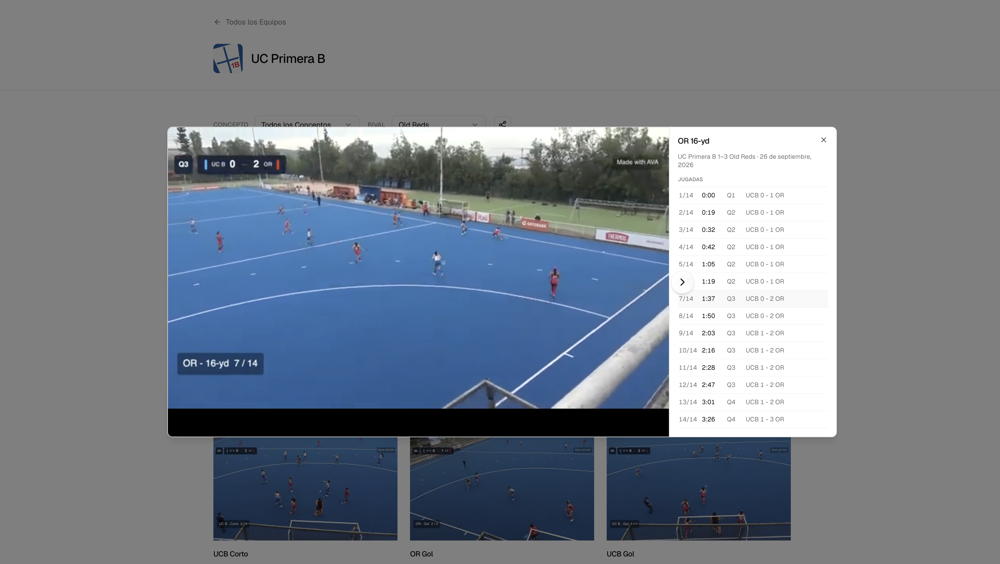
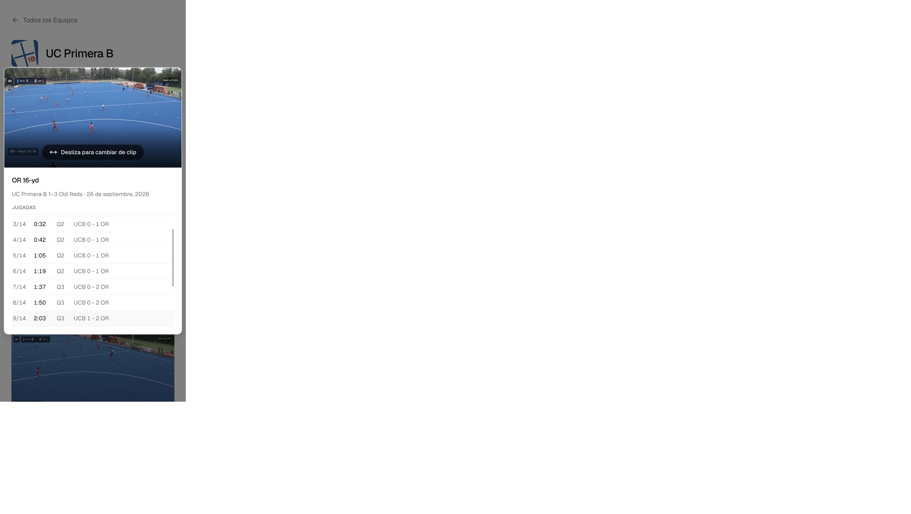

## Summary

- Add `clip_instances` D1 table and import paths (AVA sidecars + keyframe/XML backfill).
- Load `instances` on team library pages in one query; video modal **Jugadas** navigator with seek, `[` / `]`, and optional `?jugada=n`.
- Unit tests + local UCB vs OR import fixture; OpenNext build verified.

## Remote migration

```bash
pnpm exec wrangler d1 migrations apply carpeta-de-clips --remote
```

## Import summary (UCB vs OR backfill)

See `scripts/fixtures/ucb-vs-or-import-summary.txt`:

- **OR 16-yd**: 14 plays @ 233.757s (4 ambiguous XML ID paths, same timeline)
- **OR Gol**: 3 plays; **UCB Gol**: 1 play
- **UCB 16-yd**, Corto, Ingreso área: derive failed (ambiguous or no keyframe match) — use sidecars when available

Local import:

```bash
pnpm exec tsx scripts/build-ucb-or-import-payload.ts > /tmp/ucb-or.payload.json
pnpm exec tsx scripts/upsert-playlist.ts --local /tmp/ucb-or.payload.json
```

## Screenshots

| Desktop | Mobile |
|---------|--------|
|  |  |

E2E: row **7/14** → YouTube overlay **OR - 16-yd 7/14** @ ~1:37 (local preview on `localhost:8787`).

## Test plan

- [x] `pnpm test` (sidecar validation, active row, derive ambiguity)
- [x] Local D1: 14 `clip_instances` for `J9UmilJC89Q`
- [x] `pnpm run build && pnpm exec opennextjs-cloudflare build`
- [x] Modal jugada 7 overlay check (screenshots above)
